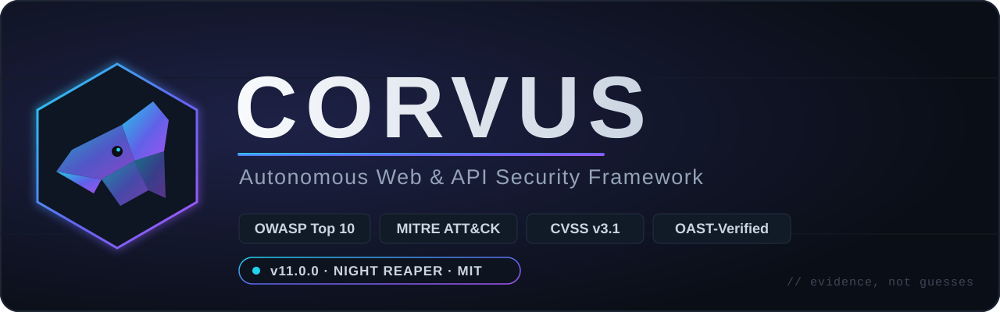
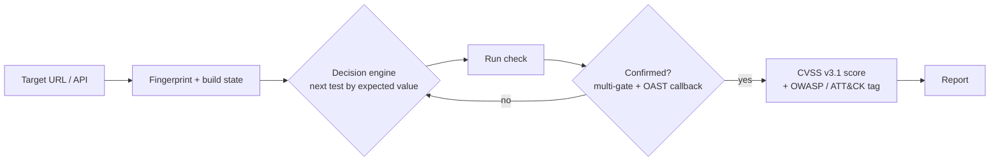

<p align="center">
  
</p>

<p align="center">
  <a href="#"></a>
  <a href="#"></a>
  <a href="LICENSE"></a>
  <a href=".github/workflows/ci.yml"></a>
  <a href="#-proof-its-real-not-fake"></a>
  <a href="#-detection-coverage"></a>
  <a href="#-external-tool-arsenal"></a>
</p>

<p align="center"><b>An autonomous offensive-security scanner that decides what to test, verifies out-of-band, and reports evidence — not guesses.</b></p>

---

## At a Glance

**What it does.** Scans web apps and APIs for vulnerabilities and scores every finding with CVSS v3.1.

**Why it is useful.** Fixed-checklist scanners waste time on dead-end tests and report guesses. CORVUS learns about the target as it goes, picks the next test by expected value, and confirms a finding before reporting it.



**What is different**
- Chooses tests from target state, not from a fixed list.
- Blind bugs (SSRF, RCE, XXE, SSTI) are reported only after a real out-of-band callback.
- CVSS v3.1 scorer is written from the spec and checked against 11 FIRST.org reference vectors.

**Impact (Google XYZ).** Built a scanner that reports only confirmed findings, verified by 43 passing tests and 11/11 FIRST.org CVSS reference vectors, by combining an expected-value decision engine, OAST verification and a from-scratch CVSS v3.1 scorer.

**Verified 2026-11-08:** `pytest` 43 passed. No false-positive-rate benchmark is published yet; none is claimed.

## Table of contents

- [Overview](#overview)
- [Why CORVUS is different](#why-corvus-is-different)
- [🔬 Proof it's real (not fake)](#-proof-its-real-not-fake)
- [Feature summary](#feature-summary)
- [🎯 Detection coverage](#-detection-coverage)
- [🧰 External tool arsenal](#-external-tool-arsenal)
- [How it works](#how-it-works)
- [Installation](#installation)
- [Usage](#usage)
  - [Autonomous engine — `corvus.py`](#autonomous-engine--corvuspy)
  - [Scan profiles](#scan-profiles)
  - [Out-of-band verification (OAST)](#out-of-band-verification-oast)
  - [Classic interface — `corvus_core.py`](#classic-interface--corvus_corepy)
  - [Enterprise scanner integrations](#enterprise-scanner-integrations)
  - [Plugins](#plugins)
- [Reporting](#reporting)
- [Testing & CI](#testing--ci)
- [Project structure](#project-structure)
- [Extending CORVUS](#extending-corvus)
- [Troubleshooting](#troubleshooting)
- [Responsible use](#responsible-use)
- [Roadmap](#roadmap)
- [Author & license](#author--license)

---

## Overview

CORVUS is a single-operator web & API attack-surface scanner built around a
**decision engine** rather than a fixed checklist. It maintains *state* about a
target and chooses the next check by expected value — high-signal modules first,
skip what the fingerprint rules out, stop when the request budget is spent.

Every finding is scored with a spec-correct **CVSS v3.1** engine and tagged to
both the **OWASP Top 10 (Web + API)** and **MITRE ATT&CK**, then exported to five
report formats. Blind vulnerability classes are confirmed by a real **out-of-band
callback**, so a finding is evidence, not a guess.

CORVUS is a **detection and reporting** tool. It finds and evidences
vulnerabilities; it does not weaponize, exploit, or persist.

> **Why the name?** *Corvus* — the raven: intelligent, watchful, autonomous.
> A hunter that thinks before it strikes.

**At a glance**

| | |
|---|---|
| Detection modules | **100** (OWASP Web Top 10 2021 + API Top 10) |
| External tool integrations | **58** (used only if present on `PATH`) |
| Default-credential pairs | **130** |
| Technology fingerprints | **85** |
| CVSS v3.1 module presets | **41** |
| Report formats | JSON · HTML · CSV · **SARIF 2.1.0** · Markdown |
| Scan profiles | Passive · Safe · Aggressive |
| Hard dependencies | just `requests` (Python 3.8+) |

---

## Why CORVUS is different

| Most scanners | CORVUS |
|---|---|
| Fire every check in a fixed order | **Decision engine** picks the next check by expected value + fingerprint gating |
| Flag on a single reflection/error | **Multi-gate confirmation** (baseline → encoding → context → out-of-band) before a finding |
| "Trust me" blind-payload findings | **OAST-verified** — blind SSRF/RCE/XXE/SSTI confirmed by a real out-of-band callback or they don't fire |
| Severity by vibes | **CVSS v3.1** scored, matched 11/11 against FIRST.org reference vectors |
| Accuracy claimed | **Live proof suite** — real findings on a bundled vulnerable target + negative controls, runnable in CI |

---

## 🔬 Proof it's real (not fake)

Accuracy claims are cheap. CORVUS ships a **deliberately-vulnerable target**
(`tests/integration/vuln_server.py`) and a **live integration test** that runs the
real detection modules against it — asserting both that true positives fire *and*
that clean endpoints stay silent (no false positives).

Try it yourself, no external target required:

```bash
python examples/demo_local_scan.py
```

```
  CORVUS demo — scanning bundled vulnerable app at http://127.0.0.1:xxxxx

  [Critical] cvss=9.1  Error-Based SQL Injection in 'id' (MySQL)      (A03/T1190)
  [High    ] cvss=4.3  Reflected XSS in Parameter 'q'                 (A03/T1059.007)
  [Medium  ] cvss=4.3  Open Redirect in 'url'                         (A01/T1071)
  [Critical] cvss=7.5  Git Repo Exposed                               (A05/T1552)
  [Critical] cvss=7.5  Environment File Exposed                       (A05/T1552)
  [High    ] cvss=5.3  Missing Strict-Transport-Security  (+5 more)   (A05/T1071)

  11 findings. Every one carries a CVSS vector, OWASP id, and MITRE technique.
```

**Negative controls prove the false-positive control works** — HTML-encoded output,
non-reflecting params, and non-injectable params all correctly produce **no finding**.

And the CVSS engine is verified against the official FIRST.org specification:

```
$ pytest tests/test_cvss.py -q
11/11 reference vectors matched FIRST.org published base scores
   9.8  CVSS:3.1/AV:N/AC:L/PR:N/UI:N/S:U/C:H/I:H/A:H   (unauth RCE)
  10.0  CVSS:3.1/AV:N/AC:L/PR:N/UI:N/S:C/C:H/I:H/A:H   (scope-changed)
   6.1  CVSS:3.1/AV:N/AC:L/PR:N/UI:R/S:C/C:L/I:L/A:N   (reflected XSS)
```

Full write-up of the audit and the bugs it caught: [`SECURITY_REVIEW.md`](SECURITY_REVIEW.md).

---

## Feature summary

**Coverage** — 100 detection modules across OWASP Web Top 10 (2021) and API Top 10;
130 default-credential pairs; 85 technology fingerprints.

**Accuracy** — spec-correct CVSS v3.1 (verified 11/11 vs FIRST.org); multi-gate
false-positive control; OAST out-of-band confirmation for blind classes.

**Autonomy** — expected-value decision engine with fingerprint gating, request +
time budgeting, baseline caching, response de-duplication, and three scan profiles.

**Integrations** — 58 external tools (nuclei, sqlmap, nmap, httpx, ffuf, sslyze,
wpscan, trufflehog, …) used opportunistically, plus optional enterprise scanners
(ZAP, Nessus, OpenVAS, Burp, Qualys, Acunetix, Tenable, Akto).

**Reporting** — JSON · HTML · CSV · SARIF 2.1.0 · Markdown, each finding carrying
CVSS score + vector, OWASP id, MITRE technique, and evidence. Supports scan
`--diff` (delta vs a previous run) and `--resume` (checkpoint recovery).

**Safe by default** — detection-only; non-interactive runs never auto-install
system packages (opt in with `--install-tools`); no `shell=True`, no `eval`/`exec`
on dynamic data.

---

## 🎯 Detection coverage

100 modules mapped to OWASP Top 10 2021 (Web) and the OWASP API Security Top 10.

**OWASP Web Top 10 (2021)**

| Category | Representative checks |
|---|---|
| **A01 Broken Access Control** | IDOR / BOLA, 403/401 bypass, open redirect, CSRF, subdomain takeover |
| **A02 Cryptographic Failures** | SSL/TLS posture, weak-crypto indicators, secret leakage in responses |
| **A03 Injection** | SQLi (error/boolean/time), XSS (reflected, multi-gate), SSTI, XXE, NoSQL, host-header, email-header, HTTP parameter pollution |
| **A04 Insecure Design** | mass assignment, business-logic flaws |
| **A05 Security Misconfiguration** | security headers, CORS, clickjacking, HTTP methods, information disclosure, sensitive files, GraphQL introspection, cache poisoning, SPF/DMARC/DKIM |
| **A06 Vulnerable Components** | outdated component detection, version fingerprinting |
| **A07 Auth Failures** | default credentials (130 pairs), JWT weaknesses, cookie flags, rate-limiting, OAuth/OIDC misconfig |
| **A08 Software & Data Integrity** | subresource-integrity gaps |
| **A09 Logging & Monitoring** | logging/monitoring exposure indicators |
| **A10 SSRF** | server-side request forgery (OAST-verified) |

**OWASP API Top 10** — BOLA, broken function-level authorization (BFLA), excessive
data exposure, API versioning/inventory, business-logic abuse, plus HTTP request
smuggling.

> Every module returns findings through a single `make_finding()` contract, so all
> 100 emit a consistent, CVSS-scored, OWASP/MITRE-tagged, serialisable result.

---

## 🧰 External tool arsenal

CORVUS orchestrates **58** best-in-class tools when they're present on `PATH` — it
never requires them, and missing tools are simply skipped.

- **Recon / discovery** — amass, subfinder, sublist3r, dnsx, dnsrecon, theHarvester, whatweb, wafw00f, httpx, katana, gospider, gau, waybackurls, waymore, paramspider, arjun
- **Content / fuzzing** — ffuf, feroxbuster, gobuster, snallygaster
- **Network / ports** — nmap, naabu, masscan
- **Vuln scanning** — nuclei, nikto, wpscan, nuclei_v8, nikto_v8, nmap_v8
- **Injection / exploitation checks** — sqlmap, dalfox, xsstrike, commix, tplmap, nosqlmap, ssrfmap, graphqlmap, jwt_tool, corsy, corscanner
- **Secrets / SCA** — trufflehog, gitleaks, semgrep, retire, js_analysis
- **TLS** — sslyze, sslscan, testssl
- **Enterprise (via API)** — OWASP ZAP, Nessus, OpenVAS/GVM, Burp Suite, Qualys, Acunetix, Tenable, Akto, ThreatMapper, Metasploit check

---

## How it works

```
          ┌────────────────────────────────────────────────────────────┐
          │                     CORVUS engine                          │
          │                                                            │
   target ─▶  recon / fingerprint  ─▶  ScanState (what we know)       │
          │          │                        │                        │
          │          ▼                        ▼                        │
          │   TECH_SIGNATURES        Decision engine  ── picks next ──┐│
          │   (85 sigs)              value = cvss·confidence·budget   ││
          │                          / cost, gated by fingerprint     ││
          │                                   │                       ││
          │                                   ▼                       ││
          │   ┌──────────── module (e.g. module_sqli) ────────────┐   ││
          │   │ multi-gate confirm: baseline → error/boolean/time │   ││
          │   │ → encoding → context → OAST callback              │   ││
          │   └───────────────────────┬───────────────────────────┘   ││
          │                           ▼                               ││
          │              Finding (+CVSS v3.1, OWASP, MITRE, evidence)─┘│
          │                           │                                │
          │                           ▼                                │
          │        JSON · HTML · CSV · SARIF · Markdown report         │
          └────────────────────────────────────────────────────────────┘
```

The engine keeps running the highest-value remaining check until the request
budget is exhausted — a fingerprinted WordPress target gets WordPress checks first
and never wastes budget on irrelevant ones. Findings feed new work back into the
state (a discovered parameter becomes a new injection candidate).

**Multi-gate confirmation** is why false positives stay low. Error-based SQLi, for
example, must pass: stable baseline → baseline has no DB error → response differs
from baseline → a DB-error signature appears → it's not inside a comment. Reflected
XSS requires the raw payload markup to survive verbatim while genuinely-encoded
output is correctly skipped. Blind classes add a real out-of-band callback gate.

Full design: [`docs/ARCHITECTURE.md`](docs/ARCHITECTURE.md) ·
Engine internals: [`docs/ENGINE.md`](docs/ENGINE.md).

---

## Installation

```bash
git clone https://github.com/m524security/CORVUS.git
cd CORVUS
pip install -r requirements.txt
```

**Requirements**
- Python **3.8+**
- The only hard dependency is `requests`.
- The 58 external tools are **optional** and used only if found on `PATH`. Install
  the ones you want (via your package manager, `go install`, etc.), or let CORVUS
  detect and skip the rest.

**Optional — auto-install missing tools** (may run `sudo apt`/`gem`/`go`):
```bash
python corvus.py https://target --install-tools
```

---

## Usage

CORVUS has one engine and two ways to drive it — pick based on how much control you want:

- **`corvus.py`** *(recommended)* — the **autonomous** entrypoint. It crawls,
  fingerprints, and lets the decision engine choose which checks to run within a
  budget. This is what most people should use.
- **`corvus_core.py`** — the **engine core and classic interface**. It's the
  library that houses all 100 detection modules, the CVSS engine, and the 58 tool
  integrations, and it exposes a fully-manual CLI (multi-target sweeps, enterprise
  scanner integrations, `--resume`/`--diff`, every report format). Use it when you
  want to run everything explicitly rather than let the engine decide.

Both share the exact same modules and scoring — `corvus.py` is the smart driver,
`corvus_core.py` is the full manual console underneath it.

### Autonomous engine — `corvus.py`

```bash
# Simplest run (safe profile)
python corvus.py https://target.example.com

# Choose a profile and cap the budget
python corvus.py https://target --profile safe --max-requests 800

# Aggressive profile (requires explicit authorization flag)
python corvus.py https://target --profile aggressive --i-have-authorization

# Enable out-of-band verification for blind classes
python corvus.py https://target --oast

# Constrain scope, load plugins, write JSON report
python corvus.py https://target --scope "*.target.com" --plugins ./plugins -o report.json
```

| Flag | Purpose |
|---|---|
| `--profile {passive,safe,aggressive}` | scan intensity (default: `safe`) |
| `--scope SCOPE` | extra scope patterns: `host`, `*.host`, or `re:REGEX` |
| `--i-have-authorization` | required to run the `aggressive` profile |
| `--max-requests N` / `--max-seconds N` | override request / time budget |
| `--oast` | enable out-of-band verification listener |
| `--oast-public` / `--oast-public-host HOST` | use a public collaborator for internet-facing targets |
| `--plugins DIR` | load drop-in plugin modules |
| `--extra-tools` | register extra integrations (testssl/retire/gitleaks/wapiti/…) |
| `-o, --output PATH` | JSON report path (default: `corvus_report_<ts>.json`) |
| `-q, --quiet` / `-v, --verbose` | quieter / per-module logging |

### Scan profiles

| Profile | Behaviour |
|---|---|
| **passive** | non-intrusive recon & observation; minimal requests |
| **safe** *(default)* | balanced, production-friendly; conservative payloads and budget |
| **aggressive** | wide payload sets, higher parallelism, deeper crawl — requires `--i-have-authorization` |

### Out-of-band verification (OAST)

Blind SSRF / RCE / XXE / SSTI only produce a finding if a unique payload token is
actually contacted out-of-band:

```bash
# Local listener (good for internal targets that can reach you)
python corvus.py https://internal.app --oast --oast-public-host 10.0.0.5

# Public collaborator (interactsh) for internet-facing targets
python corvus.py https://target --oast --oast-public
```

### Classic interface — `corvus_core.py`

Full-featured, ideal for multi-target sweeps and report-format control:

```bash
# Single URL, all report formats
python corvus_core.py -u https://target --format all

# A file of targets, 10 threads, HTML report, minimum severity Medium
python corvus_core.py -f targets.txt --threads 10 --html --min-severity Medium

# A whole subnet
python corvus_core.py --cidr 10.0.0.0/24 --output-dir ./reports

# Authenticated scan with a cookie + custom header, through a proxy
python corvus_core.py -u https://app \
    --cookie 'session=abc123' \
    --header 'Authorization: Bearer TOKEN' \
    --proxy http://127.0.0.1:8080

# Resume an interrupted scan, or diff against a previous run
python corvus_core.py -u https://target --resume
python corvus_core.py -u https://target --diff previous_report.json
```

| Flag | Purpose |
|---|---|
| `-u URL` / `-f FILE` / `--cidr CIDR` | single target / file of targets / subnet |
| `-o` / `--output-dir` | output file / directory (multi-target) |
| `--format {json,html,csv,sarif,markdown,all}` | report format(s) |
| `--html` | also emit an HTML report |
| `--cookie` / `--header` | authenticated scanning (header repeatable) |
| `--min-severity {Info,Low,Medium,High,Critical}` | filter reported findings |
| `--proxy URL` | route traffic through a proxy (e.g. Burp) |
| `--threads N` | concurrency for multi-target |
| `--no-crawl` | skip crawling |
| `--resume` / `--diff FILE` | checkpoint recovery / delta vs previous scan |
| `--nmap-mode {quick,full,vuln,stealth,aggressive,udp}` | nmap depth |
| `--install-tools` / `--no-install` | opt in to / hard-disable tool installation |

### Enterprise scanner integrations

`corvus_core.py` can pull results from commercial/enterprise scanners via their
APIs and merge them into the unified report:

```bash
python corvus_core.py -u https://target --enterprise \
    --zap-url http://127.0.0.1:8080 --zap-key <key> \
    --nessus-host https://nessus:8834 --nessus-user u --nessus-pass p \
    --burp-url http://127.0.0.1:1337 --burp-key <key>
```

Supported: OWASP ZAP, Nessus, OpenVAS/GVM, Burp Suite, Qualys, Acunetix, Tenable,
Akto, ThreatMapper (see `--help` for the full flag list).

### Plugins

Drop a `module_<name>(target, session)` function into `plugins/` and CORVUS loads
and schedules it like a built-in. Template: `plugins/example_security_txt.py`.

```bash
python corvus.py https://target --plugins ./plugins
```

---

## Reporting

Every finding — regardless of format — carries:

- `severity` and **CVSS v3.1** `cvss_score` + `cvss_vector` + `cvss_rating`
- `owasp_id` / `owasp_name` (OWASP Top 10 2021) and `mitre_id` / `mitre_technique`
- `title`, `description`, `recommendation`, `url`, `payload`, `cwe`, `evidence`, `confidence`, `timestamp`

| Format | Best for |
|---|---|
| **JSON** | pipelines, machine parsing |
| **HTML** | human review, sharing |
| **CSV** | spreadsheets, triage |
| **SARIF 2.1.0** | GitHub code-scanning, IDE integration |
| **Markdown** | tickets, PR comments |

Example JSON finding:

```json
{
  "title": "Error-Based SQL Injection in 'id' (MySQL)",
  "severity": "Critical",
  "cvss_score": 9.1,
  "cvss_vector": "CVSS:3.1/AV:N/AC:L/PR:N/UI:N/S:U/C:H/I:H/A:N",
  "cvss_rating": "Critical",
  "owasp_id": "A03", "mitre_id": "T1190",
  "cwe": "CWE-89",
  "url": "https://target/item?id=%27",
  "payload": "'",
  "evidence": "You have an error in your SQL syntax ... MySQL",
  "confidence": "High"
}
```

---

## Testing & CI

```bash
pip install -r requirements-dev.txt
pytest -q                      # 43 tests (unit + live integration)
pytest tests/integration -q    # live scan vs the bundled vulnerable app
```

**What's covered** — CVSS reference vectors (11/11 vs FIRST.org), preset integrity,
finding schema + CVSS attachment, pure helpers, import/engine smoke tests, and a
full live-scan suite with true-positive and negative-control assertions.

CI (`.github/workflows/ci.yml`) byte-compiles every source file, runs the whole
suite on **Python 3.8 / 3.10 / 3.12**, and smoke-tests both CLIs on every push.

---

## Project structure

```
CORVUS/
├─ corvus.py                  # primary entrypoint → autonomous decision engine
├─ corvus_core.py           # engine core + classic interface: CVSS, 100 modules, 58 tools, reporters
├─ corvus/                  # decision-engine package
│  ├─ engine.py               #   expected-value scheduler + fingerprint gating
│  ├─ state.py                #   ScanState: everything learned about a target
│  ├─ oast.py                 #   out-of-band callback listener
│  ├─ profiles.py             #   Passive / Safe / Aggressive
│  ├─ asynccore.py            #   throughput accelerator (optional)
│  ├─ plugins.py              #   plugin loader
│  └─ banner.py               #   CLI banner
├─ plugins/                   # drop-in community modules
│  └─ example_security_txt.py
├─ tests/                     # unit + live integration suite (43 tests)
│  ├─ test_cvss.py test_presets.py test_findings.py test_helpers.py test_smoke.py
│  └─ integration/            #   vuln_server.py + test_live_scan.py
├─ examples/
│  └─ demo_local_scan.py      # runnable, no external target needed
├─ docs/
│  ├─ ARCHITECTURE.md  ENGINE.md
│  └─ assets/corvus-banner.svg
├─ .github/workflows/ci.yml
├─ requirements.txt  requirements-dev.txt  pytest.ini
├─ CHANGELOG.md  CONTRIBUTING.md  SECURITY_REVIEW.md  LICENSE
```

---

## Extending CORVUS

```python
# plugins/my_check.py
from corvus_core import make_finding, safe_get

def module_my_check(target, session):
    findings = []
    resp = safe_get(session, target)
    if resp is not None and "X-Powered-By" in resp.headers:
        findings.append(make_finding(
            "info_disclosure",
            "Server technology disclosed via X-Powered-By",
            "Low",
            "The response advertises backend technology.",
            "Remove or obfuscate the X-Powered-By header.",
            url=target, cwe="CWE-200"))
    return findings
```

`make_finding()` auto-attaches CVSS, OWASP, and MITRE tags. Load with
`--plugins ./plugins`.

---

## Troubleshooting

| Symptom | Fix |
|---|---|
| `ModuleNotFoundError: requests` | `pip install -r requirements.txt` |
| A tool "not found" in output | that integration is optional — install the binary or ignore |
| Aggressive profile refuses to run | add `--i-have-authorization` |
| No OAST findings on an internet target | use `--oast --oast-public` (interactsh) |
| Scan too slow / too aggressive | lower `--max-requests` / `--max-seconds`, or use `--profile passive` |
| Want to run through Burp | `corvus_core.py --proxy http://127.0.0.1:8080` |

---

## Responsible use

CORVUS is for **authorized security testing only**. Scan systems you own or have
explicit written permission to test. You are responsible for staying in scope and
complying with all applicable law. The `aggressive` profile deliberately requires
`--i-have-authorization`. The authors assume no liability for misuse.

---

## Roadmap

- Unify the two front doors so the engine drives all 100 modules (today ~37 wired)
- POST / JSON-body / header injection points (core injection is GET/query today)
- Bundled DVWA / Juice-Shop CI job for broader golden-target coverage
- Split the monolith into an installable package (`corvus/…`)

---

## Author & license

**Manish Jaju** 

Released under the [MIT License](LICENSE).

<p align="center"><sub>CORVUS · Codename NIGHT REAPER · evidence, not guesses</sub></p>
